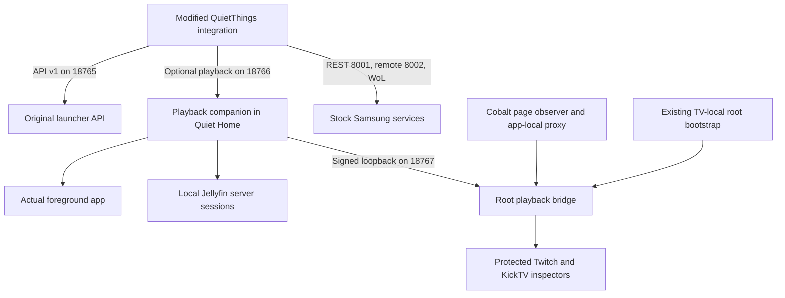

# Local Home Assistant control and playback

Status: 11 November 2026. Installed development setup on one inspected Q60C, Tizen 9, firmware 2220.4 and .NET 6.0.9. Six apps passed the stated hardware checks. This requires a customized launcher, a modified QuietThings HA integration and additional TV components. It is not an unmodified upstream installation or a universal Samsung playback API.

## What changed

Previously, Samsung supplied TV controls, Jellyfin supplied some session metadata and Cast supplied some YouTube information. Session/app identity changes could leave the universal player using an unavailable or inappropriate child. The new optional playback companion provides one stable TV entity and selects a provider using the actual foreground app.

Power, volume, source and remote navigation remain separate from playback. An open app or reachable launcher does not prove the panel is on or media is playing.

## Installed app support

| App | Actual observations | Accepted controls | Constraints |
| --- | --- | --- | --- |
| Moonfin | Playing/paused, title, duration, position and episode changes | Play, pause, finite seek, stop | Local Jellyfin session provider; launcher/player must use the same server/account. Exact TV endpoint, foreground and freshness checks apply. |
| Jellyfin | Playing/paused, title, duration and advancing position | Play, pause, finite seek, stop | Same session/account requirements as Moonfin. |
| YouTube | Actual HTML5 state, title, duration and position | Play, pause, finite-video seek | Custom ordinary-YouTube Cobalt observer/proxy. Stop is not in the accepted capability set. Readable empty menus report idle. |
| TizenTube | Actual HTML5 state, title, duration and position | Play, pause, finite-video seek | Existing proxy/modifications retained with an observer addon. Readable empty menus report idle. |
| Twitch | Actual HTML5 live state, elapsed position and stream title | HA play/pause | Title comes from channel-matched hidden player headings. Managed launch required. No finite live duration, seek or stop. Confirmed menus report idle. |
| KickTV | Actual AVPlay live state, elapsed position and broadcast title | HA play/pause | Title uses cached current-channel metadata from the app's normal Kick API. Managed launch required. Same live-control limits as Twitch. Confirmed menus report idle. |

Other apps retain applicable hardware/remote control, but reliable playback observation is not implemented for arbitrary apps. Twitch physical remote Pause failed on the earlier tested stream while HA/direct player pause and resume worked. Long live pauses, DVR and recovery after buffer expiry remain unverified. Titles depend on the inspected app markup/API; failure clears or omits titles rather than inventing one.

## Components and data flow



The original QuietThings routes remain on port 18765, with optional authenticated native `/power` and read-only maintenance status additions. The optional companion uses port 18766, its own extension version and authenticated status/control endpoints. Setting the optional playback port to zero in HA disables it and preserves original behavior.

The companion runs inside the launcher. Home.HomeAssistant.cs supplies foreground, local account and route callbacks and registers providers. The additional root bridge is a separate service started after the existing TV-local boot-root chain. The one-shot boot helper is not itself a permanent media collector. Optional signed startup resources retain the original recovery pair and fall back if the optional pair is missing or invalid.

### Moonfin and Jellyfin

Session selection checks foreground client, exact TV endpoint, signed-in user and freshness, rejecting stale/ambiguous matches. Credentials and internal session IDs are not sent to HA. Selection is repeated before controls and after network reads so an old response cannot revive the previous app's media.

A replacement session can be discovered after reinstall without replacing the HA dashboard entity. Automated tests cover this selection; an actual client reinstall was not hardware-certified. Controls wait for real acknowledgement from the same session within a bounded deadline, rather than declaring success optimistically.

### Twitch and KickTV

Managed launches open protected app inspectors. Twitch exposes its actual HTML5 player; KickTV exposes AVPlay. A small KickTV context observes successful opens and reads the channel label without persisting a package patch. Reopening even the same channel changes player ownership and invalidates stale controls.

Twitch's generic media metadata was empty, but the active page retains hidden sibling headings for channel and stream title. The context checks the current channel route and heading identity and rejects ambiguous or mismatched headings. Title edits do not retire the player lease. KickTV uses its current channel label to retrieve session_title from the same channel metadata API the app uses. This adds a bounded HTTPS lookup, not an extra HA cloud account: one request in flight, five-second timeout, 30-second refresh and 90-second maximum stale lifetime. Lookup runs on observation reads only for a ready player. Channel changes, source-generation changes, menus, offline/error/loading views and wrong-channel responses cannot reuse an old title. Initial title arrival can take until a later HA poll.

App-specific menu detection distinguishes Twitch browse routes and KickTV's Home/player visibility. Confirmed menus produce idle and clear title/timing/commands; loading or failed player views remain unknown. This also prevents incidental Twitch browse previews from being presented as the primary player.

The Samsung inspector binds a random port on network interfaces. The root helper guards launch-time exposure, installs loopback-only access rules and checks IPv4/IPv6 rule sets. A localhost client alone is insufficient protection. Page origin, application identity, process/boot identity and player leases are verified.

Both dock tiles and custom remote remaps call the same managed Launch path. A remap to Twitch/KickTV works from other foreground apps; Home need not be opened first. A launch through an unrelated Samsung/third-party route is not silently interrupted and relaunched to attach an inspector.

### YouTube and TizenTube

Both aliases share Samsung's native Cobalt foreground ID. Attested document/proxy mode distinguishes them. Ordinary YouTube uses a separate loopback proxy on 127.0.0.2:8102; TizenTube keeps its original proxy on 8101 and its existing modifications. Ordinary mode does not load TizenTube's ad/UI script, but is still custom instrumentation.

The page observer reads actual HTML5 state and emits bounded observations approximately every 750 ms while active. The apps still use their normal internet streaming services. Local means control/observation needs no added cloud relay, not that online streaming works offline.

Recommendation launching supplies mode-specific native arguments, waits for an attested ready document, then delivers one video payload. Fresh per-launch URL markers prevent cached HTML from replaying old observer capabilities. The attempted production-Cobalt debugger route did not expose an inspector; this implementation uses app-local observation instead.

Active Cobalt may run behind Samsung's generic app-defined-loader after boot. Attestation checks its kernel package label, native arguments, executable Cobalt mapping and actual socket ownership. Executable filename alone was insufficient.

## HA entities and dashboard

The living-room setup keeps a stable QuietThings playback entity and the existing universal player as dashboard facade. QuietThings now supplies power state, power commands and volume/mute commands/readback; Samsung retains source control and existing remote keys. Supported popup play/pause targets QuietThings; unknown playback keeps explicit Samsung fallback. The universal player's explicitly configured Samsung transport routes are not all replaced by companion commands.

Capabilities come from each current observation. Live streams do not acquire seek simply because a VOD provider supports it. After controls HA requests an immediate actual refresh, avoiding the earlier refresh-request cooldown that delayed resume feedback. Apps, server reporting and LAN latency still matter.

The tile and popup update display-only progress every second from actual position, timestamp and playing state. Paused progress holds; absent finite duration hides the bar. This is visual interpolation corrected by observations, not a fresh TV sample every second. The custom bars are read-only. VOD seek works through the integration/API, not a draggable bar in this popup. Artwork support is not established for all providers.

Title/status templates read the playback child directly when the universal player's idle-child fallback would hide the app name. Hardware off wins.

| Condition | Popup example |
| --- | --- |
| Confirmed empty YouTube/TizenTube menu | YouTube or TizenTube / Nothing Playing |
| Confirmed idle Moonfin/Jellyfin session | App name / Nothing Playing |
| Quiet Home foreground | Quiet Home / Nothing Playing |
| Supported playing/paused media with title | Title / Playing or Paused, with app name when available |
| Twitch/KickTV live playback with available title | Broadcast title / Playing or Paused, with Twitch or KickTV |
| Confirmed Twitch/KickTV menu | App name / Nothing Playing |
| Unobservable playback | Available app/source name, otherwise TV / Playback status unavailable |
| Hardware off or unavailable entity | Off or Unavailable as applicable |

The compact tile has a shorter label; it does not reproduce every popup subtitle. The dedicated QuietThings entity exposes app_name, app_id, media_title and its playing/paused/idle state. There is no separate entity per open app. The universal player can select its Samsung child while playback is idle and lose app attributes, which is why the dashboard reads the QuietThings child directly. For a current-app template or automation, use the dedicated QuietThings entity. Unsupported/error states remain distinct from confirmed menus.

### Reading the current app in HA

Use the existing `media_player.quietthings_living_room` entity, including when the app is in a confirmed menu:

```jinja
{{ state_attr('media_player.quietthings_living_room', 'app_name') }}
{{ states('media_player.quietthings_living_room') }}
{{ state_attr('media_player.quietthings_living_room', 'media_title') }}
```

These return app name, playback state and title respectively. `idle` means a confirmed menu or no media; `on` alone means playback is unknown. A title is absent in menus. No separate app entity is required.


## Persistent Home startup repair

Owner review exposed power-on opening the input viewer while Home still worked. Main-operation and home_appid were correct. Changing startup_appid alone failed across a controlled restart. Samsung's separate db/menu/smart_hub/ontvsetting/auto_start integer policy was zero. Enabling it and restoring the native startup selector fixed automatic Home startup without a launcher binary change.

A subsequent full boot and input-to-Home standby/wake passed through foreground, power and HA readbacks. Physical screen/remote observation was unavailable for this final repair. See [manual](MANUAL.md#7-assign-home-and-startup-after-accepting-the-trial) and [recovery](RECOVERY.md#restore-homestartup-and-stock-package) for typed values, backups and targeted inverse. A legacy first-screen value was not needed for the repair.

Startup and HA wake reliability are separate. A later investigation reproduced Samsung REST reporting standby while YouTube was actually playing. The updated launcher exposes authenticated GET `/power`, reading `Tizen.System.Display.State` on the UI thread: Normal/Dim mean on, Off means off. The response contains `power_source: tizen-display` and an observation timestamp. HA accepts only fresh, valid native observations and uses them before Samsung REST, including power-command guards. Missing/unknown native support falls back to the original Samsung behavior. An app process or background playback alone does not establish display power.

The living-room universal entity now routes state and turn_on/turn_off through QuietThings. Two actual HA digital-remote off/on cycles passed without a physical remote, including 45 seconds in standby, while Samsung could still report standby after wake. Native off clears playback metadata even if a background provider responds. Diagnostic attributes expose `power_source` and `samsung_power_state`. These checks fix the reproduced stale-state fault; every firmware, long sleep duration and network wake condition is not certified.

## Security and maintenance

Both LAN APIs require the existing bearer token and use plain HTTP on the trusted LAN. Do not expose them to the internet. The loopback root bridge uses signed requests/responses, fresh nonces and fixed bounded operations, not arbitrary shell/JavaScript/file access. Cobalt has a separate observer credential; neither credential is delivered to pages or HA. Signed source URLs used to distinguish players remain in page memory.

The proxy uses app-local trust assets, not a global trust replacement. Boot/inspector handling depends on inspected firmware, runtime, labels and paths. App/firmware updates may require reinspection. Existing privacy masks and remote remaps are preserved but are not intrinsic playback-protocol requirements. This is not a zero-telemetry or universally compatible setup.

Fresh backups and per-file/per-key guarded inverses are required before updates. Do not rerun initial installers or replace live registries with old snapshots. Refresh only an exact idle .NET preloader when a replaced DLL remains cached. Private evidence, tokens, keys and proprietary assets stay outside public documentation.

## Validation and release state

Recorded checks include real controls in six apps, app/mode switching and stale-command rejection, controlled boot/standby, restored volume/mute and preserved accounts, eight remote grabs and privacy masks. Latest recorded suites: 123 HA tests on each of two Core targets, 126 shared playback checks, 11 Cobalt launch checks and 315 original API checks, plus bridge/observer/JavaScript suites. These results were not rerun for this documentation-only update.

Later title/menu update: real broadcast titles reached HA for two channels in each live app; pause/resume retained title and correct app identity, and Back to both app menus cleared media and reported idle. The current update passed 131 shared playback checks, 21 bridge checks, 22 Python HTTP/lifecycle tests, title/context JavaScript tests and Cobalt client/proxy regressions. Launcher/bridge builds had zero warnings/errors. No HA Python/UI deployment or restart was needed. This title build did not undergo another full TV reboot, and did not itself certify wake behavior. The later native-power acceptance above supersedes the reproduced stale Samsung on-state problem.

HA 2026.5.4 uses stock samsungtvws 2.7.2; the other target is HA 2026.10.4 with samsungtvws 3.0.7. Do not force the newer library under the older core. Build with matching private TV references as described in the manual. Companion/bridge tests and installation contracts are in the [QuietThings fork](https://github.com/AnthonMS/QuietThings), experimental/playback/.

No hardware certification is claimed for arbitrary TVs/apps, actual client reinstall, IPv6 LAN probing, HDMI switching in this playback campaign, long live DVR pauses or prolonged memory pressure. Earlier physical UI checks and final unattended startup readbacks are different evidence. Daily-use acceptance remains ongoing.

[Upstream PR 1](https://github.com/magnetgrouplabs/QuietThings/pull/1) is closed and held at the owner's request. This six-app stack is not merged upstream. General fixes and optional HA protocol support could be separate future contributions; specialized TV deployment is a larger packaging/maintenance task. Documentation work does not authorize commits, pushes or reopening.

## Source map

| Location | Responsibility |
| --- | --- |
| quiet-tizen/launcher/src/Home.HomeAssistant.cs | Host callbacks, providers and managed app/video launch |
| quiet-tizen/launcher/src/Home.Remote.cs | Remote shortcuts use that same launch path |
| quiet-tizen/launcher/src/QuietThingsPlayback/ | Shared companion, selection, commands and leases |
| QuietThings custom_components/quietthings/playback.py and media_player.py | HA client, properties and capability handling |
| QuietThings experimental/playback/bridge/ | Root transport, inspector lifecycle and Cobalt ownership |
| QuietThings experimental/playback/web/ | Player probes, Kick context, Cobalt proxy/client |
| quiet-tizen/tools/boot-privacy/ and tools/prepare_boot.py | Optional signed boot-resource selection/staging |

## Local settings and TV notifications

Settings, More settings, Home Assistant now provides persistent access, notification and action-button switches plus connection details. HA initiates the local connection; no hardcoded Home Assistant destination is stored in the launcher. Change the TV address and companion settings in the HA integration.

The modified integration adds `quietthings.notify` and `quietthings.dismiss_notification`, camera snapshot preparation and short-lived `quietthings_notification_action` events. The TV uses a silent native corner overlay that automatically captures navigation and releases it on dismissal or timeout. See [TV notifications](NOTIFICATIONS.md) for service fields, examples, privacy, acceptance evidence and limits. The owner's separate HA package now contains the requested doorbell and Unlock Door callback automations; actual lock operations are excluded from development tests.


## November 12: sleeping wake and volume readback correction

A longer standby exposed a second failure after the native power-state fix. HA stopped invoking turn_on because the QuietThings media entity became unavailable after repeated sleeping-endpoint failures. The player now remains available as a local Wake-on-LAN command target. Power remains unknown when it cannot be observed; sensors and API-dependent controls retain their availability checks. Toggle checks fresh power and attempts wake for off/unknown. The living-room universal entity explicitly forwards toggle as well as turn_on/turn_off, avoiding HA's default unknown-to-turn_off behavior.

Volume write/readback now both use QuietThings. Previously, the universal entity still read Samsung's volume attributes while Samsung reported stale off and omitted those attributes. The native API and QuietThings already had the correct value. Moving the slider's authority and commands together fixes the empty readback without guessing volume from writes.

The previous implementation was reproduced as unavailable after roughly 80 seconds, with an actual ignored wake request. After the fix, the same sleeping TV woke from the dashboard toggle without a physical remote. Actual YouTube volume changes 10% to11% to12% to10% read back on both entities; ten captured HA state events contained no playback interruption/unavailable state, and position continued. All194HA tests passed on each supported Core. No TV binaries, pairing, accounts, remote remaps or privacy settings changed. These bounded tests do not certify every overnight/router/firmware wake condition.
